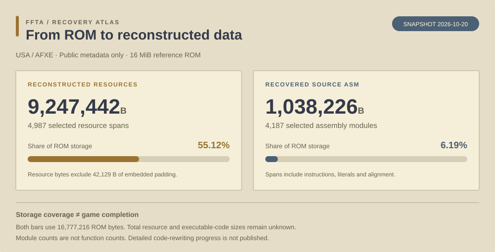

# fftadecomp

Public recovery statistics and resource-address metadata for **Final Fantasy Tactics Advance (USA / AFXE)**. This repository publishes recovery data and its static presentation. It does not contain the game, extracted assets, decompiled code, build tools or implementation designs.

Snapshot: **2026-10-22**. This is a standalone progress-data project, not an official Square Enix project or a fork of another similarly named repository.

[**Open the Recovery Atlas →**](https://gh.bhee.online/fftadecomp/)

## Recovery snapshot

Exact figures and measurement definitions

| Measurement | Verified snapshot | Denominator / interpretation |
| --- | ---: | --- |
| Reconstructed resource bytes | 9,247,442 B | 55.1190% of the 16,777,216-byte ROM; total resource size is not established |
| Selected resource spans | 4,987 | May contain shared resources or collections; not an in-game object count |
| Resource-span storage | 9,289,571 B | Includes 42,129 B of embedded padding, excluded from resource bytes above |
| Selected source ASM spans | 930,522 B | 5.5463% of the ROM; total executable-code size is not established |
| ASM instruction bytes | 822,766 B | Included in the span total above |
| ASM literals/tables | 100,720 B | Included in the span total above |
| ASM alignment/padding | 7,036 B | Included in the span total above |
| Selected ASM modules | 3,939 | Modules are not function counts |
| Selected readable C rewrite spans | 174,718 B | 963 C modules / 1,050 compiled entries; 1.0414% of ROM storage, not a code-completion percentage |
| C output matching retail exactly | 29,732 B | 605 function bodies match every byte |
| C output with pinned differences | 144,986 B | 445 entries; 18,221 same-offset matches and 126,765 differing byte positions |
| Mixed C/ASM spans | 10,520 B | Seven modules / nine generated entries; 26 ASM instruction bytes, separately counted from pure C |
| Original-byte dependencies | 365,533 B | Includes retained suffixes, data and padding; not unknown executable bytes |

These are reconstruction and storage measurements. The C figures distinguish exact output from readable C output that still differs from retail; pinned differences are byte-comparison results, not claims that behavior is complete. The total executable-code denominator is unknown, so the C span share must not be read as the percentage of code rewritten or gameplay completed. Relocated C bodies and retained assembly suffixes are accounted for separately.

## Latest integrated milestone

Mission candidate collection and replacement now integrates **1,412 C bytes** from a 1,452-byte original method, with 40 original suffix bytes retained. Twenty-two actual-image cases pass, including two independent counterexamples that rejected the earlier implementation. This method has **zero whole-function exact-match credit**. Natural gameplay and physical hardware remain unproved.

Since the previous snapshot, six mission-policy methods add 3,556 integrated C bytes, including one 140-byte whole-function exact method. The new mission-progression submodule separates this bounded implementation evidence from unresolved natural story, mission and persistence coverage.

The latest method took 13,022.564 seconds from the original work start through verified integration: **390.34 accepted/integrated C B/hour and zero new exact B/hour**. Failed attempts, source repair, profile transition and handoff gaps remain included. The earlier four-method exact milestone delivered 514.03 exact B/hour over its own 8,012.002-second pipeline; these are distinct cohorts and denominators. No >5x workflow speedup is claimed.

Source-structure matching continues in two disjoint implementation lanes under fixed O2 for new candidates. Older accepted images retain their recorded provenance and are not rebuilt merely to change the profile. Pending candidates are excluded from integrated totals.

## Data

- [Progress summary](data/progress.json)
- [Submodule implementation progress](data/submodules.json) — 40 disjoint groups with C/mixed counts, verified scope and remaining work
- [Resource address table — CSV](data/resource-addresses.csv)
- [Resource address table — JSON](data/resource-addresses.json)

Resource tables expose only synthetic snapshot IDs, ROM offsets, GBA addresses, exclusive end offsets and byte counts. They contain no resource payloads, filenames, decoding rules or function addresses. GBA addresses use base `0x08000000`. The table covers selected reconstructed spans only; omitted ranges must not be assumed unused or unknown. IDs are snapshot identifiers, not original game IDs.

Counts were reconciled against a validated reconstruction report and the selected source/resource inventories. The C counts are tied to the pinned retail input, candidate image and build-report hashes in `data/progress.json`; they distinguish exact C output from nonmatching C output with pinned byte differences. Address spans were checked for overlap; resource bytes plus embedded padding equal their listed spans. Public data alone does not reproduce the private build validation.

## Publication boundary

Published recovery content consists of aggregate statistics, system inventory counts and resource-address metadata. The static dashboard also includes presentation files and attributed third-party title artwork; see [display credits](assets/ATTRIBUTION.md). Game source code, ASM listings, ROMs, extracted graphics, audio, dialogue, saves, design documents, private paths, conversations, prompts and task records are excluded. This repository starts with an independent history.

## License

The original documentation and published metadata in this repository are available under [CC BY 4.0](https://creativecommons.org/licenses/by/4.0/). This license does not grant rights to the game or its assets.

## Daily updates

Update the verified files in `data/` and the README snapshot together. Pushes deploy the dashboard automatically; a daily scheduled deployment republishes the committed snapshot without changing its date. No private repository is connected. Reference categories follow the [FFSKY FFTA guide](http://ffta.ffsky.cn/); ROM record counts are not playable-content counts.
